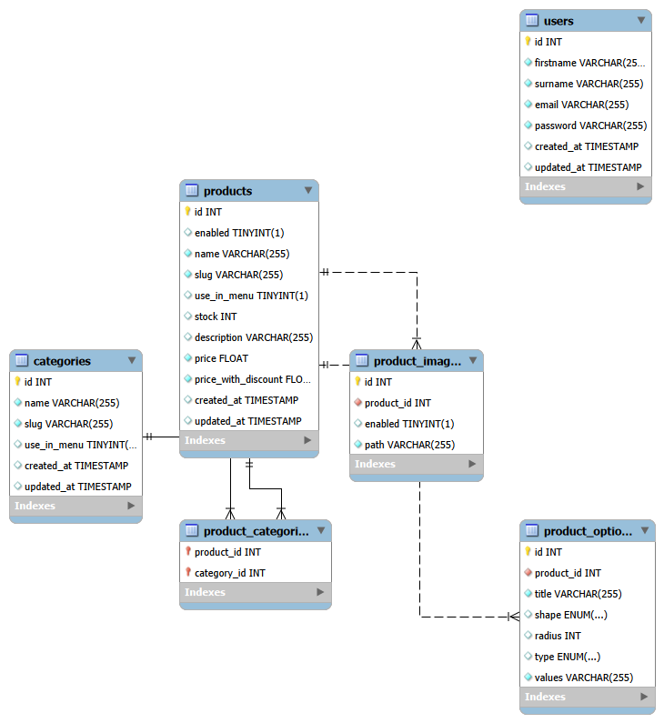

# Digital Store API: Projeto Backend

API RESTful completa para e-commerce, desenvolvida como projeto final do Projeto Backend do curso Desenvolvedor Web Full Stack da Geração Tech do Instituto Euvaldo Lodi (IEL). A aplicação oferece gerenciamento de produtos, usuários, categorias e autenticação para lojas virtuais. O projeto demonstra operações CRUD, autenticação segura, modelagem de dados e arquitetura escalável, servindo como base para aplicações de comércio eletrônico.

Repositório de referência: https://github.com/digitalcollegebr/projeto-backend

## Tecnologias

O projeto foi desenvolvido com tecnologias modernas do ecossistema JavaScript, garantindo eficiência, segurança e facilidade de manutenção.

### Essenciais
- Node.js: runtime JavaScript para desenvolvimento server-side
- Express.js: framework web minimalista e flexível para Node.js
- Sequelize: ORM avançado para Node.js com integração ao MySQL
- MySQL: sistema de gerenciamento de banco de dados relacional

### Comunicação com banco
- MySQL2: driver MySQL nativo para Node.js com suporte a Promises

### Segurança e autenticação
- JSON Web Tokens (JWT): autenticação baseada em tokens
- Bcrypt.js: criptografia segura de senhas
- CORS: configuração para requisições cross-origin

### Desenvolvimento, testes e documentação
- Nodemon: reinicialização automática durante o desenvolvimento
- Jest: framework de testes JavaScript
- C8: cobertura de código
- Swagger UI: documentação interativa da API em `/api-docs`
- Supertest: testes de APIs HTTP

## Requisitos de avaliação

### 1. Funcionalidades essenciais
- Implementação completa dos endpoints especificados
- Operações CRUD para todas as entidades principais
- Sistema de autenticação e autorização robusto
- Tratamento adequado de erros e validações

### 2. Qualidade do código
- Código limpo, comentado e bem estruturado
- Aplicação de boas práticas de desenvolvimento
- Arquitetura organizada seguindo padrões estabelecidos

### 3. Banco de dados
- Modelagem eficiente e normalizada
- Implementação adequada de migrations
- Consultas otimizadas e relacionamentos bem definidos

### 4. Documentação
- Documentação completa da API
- Instruções claras de configuração
- Guias de uso e exemplos práticos

## Principais funcionalidades

### Gestão de usuários
- Cadastro completo de usuários com validações
- Armazenamento seguro de credenciais com hash
- Autenticação via JWT
- Middleware de proteção para rotas privadas

### Gerenciamento de produtos
- CRUD completo para produtos e suas variações
- Sistema de categorização flexível
- Gerenciamento de imagens e opções de produtos
- Busca avançada com múltiplos filtros

### Sistema de categorias
- Organização hierárquica de produtos
- Operações completas de gerenciamento
- Associações dinâmicas com produtos

### Recursos avançados
- Arquitetura em camadas (Controllers, Services, Models)
- Filtros de busca por nome, preço e categoria
- Servidor Express otimizado para alta performance
- Testes automatizados abrangentes

## Endpoints da API

A API utiliza o prefixo `/v1` para versionamento das rotas.

| Método | Endpoint | Descrição | Autenticação |
| --- | --- | --- | --- |
| `POST` | `/user/token` | Autenticação e geração de token JWT | Não |
| `GET` | `/user/:id` | Consultar usuário por ID | Não |
| `POST` | `/user` | Cadastrar usuário | Não |
| `PUT` | `/user/:id` | Atualizar usuário | Sim |
| `DELETE` | `/user/:id` | Deletar usuário | Sim |
| `GET` | `/category/search` | Listar categorias com filtros | Não |
| `GET` | `/category/slug/:slug` | Consultar categoria por slug | Não |
| `GET` | `/category/:id` | Consultar categoria por ID | Não |
| `POST` | `/category` | Cadastrar categoria | Sim |
| `PUT` | `/category/:id` | Atualizar categoria | Sim |
| `DELETE` | `/category/:id` | Deletar categoria | Sim |
| `GET` | `/product/search` | Busca avançada de produtos | Não |
| `GET` | `/product/slug/:slug` | Consultar produto por slug | Não |
| `GET` | `/product/:id` | Consultar produto por ID | Não |
| `POST` | `/product` | Cadastrar produto | Sim |
| `PUT` | `/product/:id` | Atualizar produto | Sim |
| `DELETE` | `/product/:id` | Deletar produto | Sim |

## Configuração e execução

### Pré-requisitos
- Node.js 18 ou superior
- MySQL 8 ou MariaDB 10.5 ou superior em execução
- Git

### Passo a passo

```bash
# 1. Clone o repositório e entre na pasta do backend
git clone <URL-DO-SEU-REPOSITORIO>
cd projeto-backend

# 2. Instale as dependências
npm install

# 3. Crie os bancos de dados de desenvolvimento e testes
mysql -u root -p -e "CREATE DATABASE projeto_backend; CREATE DATABASE projeto_backend_test;"

# 4. Configure as variáveis de ambiente
cp .env.example .env

# 5. Edite o arquivo .env com sua senha do MySQL e um JWT_SECRET
# 6. Crie as tabelas por meio das migrations
npm run migrate

# 7. Opcional: popule com dados de exemplo
npm run seed

# 8. Inicie o servidor
npm run dev
```

A API sobe em `http://localhost:3000`. A documentação interativa Swagger, em OAS 3.0, fica em `http://localhost:3000/api-docs`. Para testar rotas protegidas, gere o token em `/v1/user/token` e informe `Bearer <seu_token>` no botão Autorizar.

O usuário de exemplo do seed é `admin@email.com` com senha `123456`.

### Variáveis de ambiente (`.env`)

| Variável | Descrição |
| --- | --- |
| `PORT` | Porta da API (padrão 3000) |
| `JWT_SECRET` | Segredo para assinar os tokens (obrigatório) |
| `DB_HOST` | Host do MySQL |
| `DB_PORT` | Porta do MySQL |
| `DB_USER` | Usuário do MySQL |
| `DB_PASSWORD` | Senha do MySQL |
| `DB_NAME` | Banco de desenvolvimento |
| `DB_NAME_TEST` | Banco usado somente nos testes (padrão `<DB_NAME>_test`) |
| `DB_DIALECT` | Dialeto do banco, normalmente `mysql` |

Nunca faça commit do arquivo `.env`. Ele já está no `.gitignore`.

Se preferir usar o nome `digital_store`, ajuste `DB_NAME` e os comandos de criação do banco de acordo.

### Scripts

| Comando | O que faz |
| --- | --- |
| `npm run dev` | Servidor com reinício automático via nodemon |
| `npm start` | Servidor em modo normal |
| `npm run migrate` | Aplica as migrations |
| `npm run migrate:undo` | Desfaz as migrations |
| `npm run seed` | Insere dados de exemplo |
| `npm test` | Roda os testes usando o banco `DB_NAME_TEST` |
| `npm run coverage` | Roda os testes com relatório de cobertura |

## Autenticação

1. Cadastre-se em `POST /v1/user` ou use o usuário criado pelo seed.
2. Faça login em `POST /v1/user/token` com `email` e `password` e copie o `token`.
3. Envie `Authorization: Bearer <token>` nas rotas marcadas como protegidas.
4. Token ausente ou inválido responde `401`.
5. Um usuário só pode alterar ou excluir a si mesmo. Tentativa de alterar outro usuário responde `403`.

## Busca de produtos (`GET /v1/product/search`)

| Parâmetro | Exemplo | Descrição |
| --- | --- | --- |
| `limit` | `12` | Itens por página; `-1` retorna todos (padrão 12) |
| `page` | `2` | Página (padrão 1) |
| `match` | `Tênis` | Busca no nome ou na descrição |
| `category_ids` | `15,24` | Produtos de qualquer uma das categorias |
| `price-range` | `100-200` | Faixa de preço |
| `option[45]` | `GG,PP` | Produtos cuja opção 45 tem algum dos valores |
| `fields` | `name,images,price` | Campos a retornar |

Os filtros podem ser combinados. A resposta tem o formato `{ data, total, limit, page }`.

## Códigos de resposta

| Código | Quando |
| --- | --- |
| `200`, `201`, `204` | Sucesso em consulta, criação, atualização ou exclusão |
| `400` | Dados ausentes ou inválidos |
| `401` | Token ausente ou inválido |
| `403` | Tentativa de alterar outro usuário |
| `404` | Registro ou rota inexistente |
| `500` | Erro inesperado, sem vazar detalhes |

## Modelagem do banco

Script SQL completo em [`database/projeto_backend.sql`](database/projeto_backend.sql) (alternativa às migrations: `mysql -u root -p < database/projeto_backend.sql`).



## Estrutura do projeto

```text
src/
├── config/        # conexão com o banco e configuração do sequelize-cli
├── controllers/   # camada HTTP: valida a entrada e monta a resposta
├── services/      # regras de negócio (produtos, imagens, hash, token)
├── validators/    # validação das entradas de produto
├── models/        # models Sequelize e relacionamentos
├── migrations/    # estrutura do banco versionada
├── seeders/       # dados de exemplo
├── middleware/    # autenticação JWT e tratamento global de erros
├── routes/        # definição das rotas /v1
├── docs/          # especificação OpenAPI (Swagger)
└── utils/         # funções auxiliares
tests/             # testes automatizados (Jest e Supertest)
```

## Equipe

LUCAS MATHEUS DANTAS RIBEIRO
